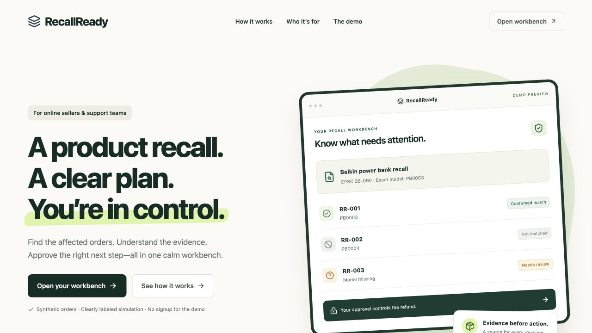
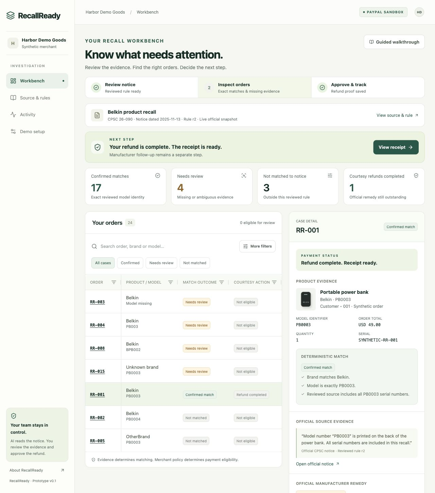

# RecallReady

A merchant workbench for official product-recall evidence, deterministic order triage, and independently approved courtesy refunds.

**Working local simulation and verified live CPSC-to-Gemini source extraction. A buyer-approved PayPal sandbox purchase and USD 49.00 refund are completed, with provider-verified proof saved. The original refund was recovered through GET after a sandbox response-link parsing error; the repeated request returned the same attempt. All credentials are loaded privately from the server environment.**

## Preview





## Run locally

Use Node.js 22.12+ (the Docker runtime is pinned to Node 22.14.0) and Docker Desktop.

```sh
npm ci
cp .env.example .env
docker compose up -d db
npm run db:migrate
npm run dev
```

In a second terminal:

```sh
npm run worker
```

Open http://localhost:3000 and choose **Open isolated simulation**. The initializer creates its own session, workspace, source fixture, reviewed demonstration rule, policy, and 24 synthetic orders. `db:seed` is optional; the browser creates its own isolated scenario.

For all three services in containers:

```sh
cp .env.example .env
docker compose up --build -d
```

## Demonstrate the core

1. Inspect RR-001: exact Belkin PB0003, a reviewed all-serial rule, and a separate merchant policy.
2. Inspect RR-002: PB0004 is not matched to this notice. This is not a safety certification.
3. Inspect RR-003: a missing model requires evidence; the financial action is disabled.
4. Return to RR-001, review the exact USD 49.00 proposal, deliberately confirm, and approve the courtesy refund.
5. The PostgreSQL worker processes the simulated provider action. The receipt remains labeled **SIMULATION**.
6. Use **Re-submit this approval**. The backend returns the same lifetime attempt.
7. Use the walkthrough's RR-021 timeout scenario. It stays unknown and offers reconciliation without resending a refund.

The CPSC description's PB0003 and the caption's PB003 remain different identifiers. The reviewed simulation rule explicitly uses the description; PB003 stays a review case. A courtesy refund never changes the manufacturer claim or official-remedy state.

## Verification

```sh
npm test
npm run eval:matching
npm run eval:extraction
npm run typecheck
npm run lint
npm run build
docker compose exec -T db createdb -U recallready recallready_test
npm run test:integration
npx playwright install chromium
# Keep the app and worker running for browser tests.
npm run test:e2e
npm run demo:verify
```

`createdb` is needed once. The integration suite uses **TEST_DATABASE_URL**, creates isolated test workspaces, and never invokes a live payment adapter. Do not point it at a production database. Matching reports measure deterministic labels; fixture extraction reports measure validation behavior, not model accuracy. `source:verify` is a deliberate read-only real CPSC request. `demo:verify` never refunds.

## Real integrations

The current AI provider is Gemini with JSON Schema output and `gemini-3.1-flash-lite`. Configure `GEMINI_API_KEY` and `AI_PROVIDER=gemini`. Groq (`AI_PROVIDER=groq`, `GROQ_API_KEY`) and OpenAI (`AI_PROVIDER=openai`, `OPENAI_API_KEY`) remain explicit alternatives. Keys stay server-side and are never printed by verification commands. Provider failures do not fall back to simulation.

Follow [Setup](docs/SETUP.md). Configure the PayPal sandbox REST app, expected business merchant ID, and Gemini key securely in `.env`. Restart app and worker. Create owner credentials interactively with `npm run owner:create`, choosing `PAYPAL_SANDBOX`, then sign in.

Demo setup provides PayPal buyer approval for the server-owned USD 49.00 order. Only the server captures and verifies it. Recheck the official source, wait for the extraction, and explicitly promote the reviewed rule. Finally, review and approve the refund from Workbench. The worker checks the provider's order, capture, merchant, currency, amount, and current approval before a single POST, then verifies the refund by GET.

After an actual completed refund, `npm run demo:record -- --attempt <UUID>` verifies provider records and saves **RECORDED_SANDBOX_EVIDENCE**. It only performs reads; it cannot issue a refund. No proof rows are fabricated.

## Documentation

- [Architecture](docs/ARCHITECTURE.md)
- [Security and recovery](docs/SECURITY.md)
- [Evaluation methodology](docs/EVALUATION.md)
- [Demo playbook](docs/DEMO.md)
- [Submission preparation](docs/SUBMISSION.md)
- [Build status and remaining gates](docs/BUILD_STATUS.md)
- [Original authoritative contract](docs/BUILD_CONTRACT.md)

## Source and boundaries

Official CPSC recall 26-090, displayed date November 13, 2025: [Belkin recall notice](https://www.cpsc.gov/Recalls/2026/Belkin-Recalls-Portable-Power-Banks-and-Wireless-Charging-Stands-Due-to-Fire-and-Burn-Hazards). The cached fixture is attributed; its presence does not establish a live freshness check. The CPSC REST/page adapter was independently exercised and its result is recorded in `docs/reports/source-live.json`.

All people, emails, prices, serial values, and orders are synthetic. There is no manufacturer partnership, manufacturer claim filing, real-money operation, merchant validation, or measured injury reduction. No merchant interviews or three-person comprehension study have been completed.

AG Grid Community 36.3.0 is implemented. AG Studio, customer message drafts, and webhooks are not implemented in this release. There is no unverified webhook route or public model proxy. Original code is licensed under [MIT](LICENSE); see [third-party notices](THIRD_PARTY_NOTICES.md) for dependency and source attribution. The source repository is published for the hackathon; public application hosting and the final demo video remain separate release steps.

### Submission recording evidence

The November 8, 2026 recording used a fresh buyer-approved sandbox purchase and a separately approved USD 49.00 courtesy refund. [Redacted recording proof](docs/reports/submission-recording-sandbox-proof.json) reports authoritative PayPal GET verification and one attempt, one dispatch, and one execution job after repeated execution. Original human-approval footage is retained; later layout pickups preserve the completed transaction. [Narration and shot plan](docs/video/SUBMISSION_SCRIPT.md) is provided for the owner’s manual voiceover. Local video files are excluded from Git and Docker images.
