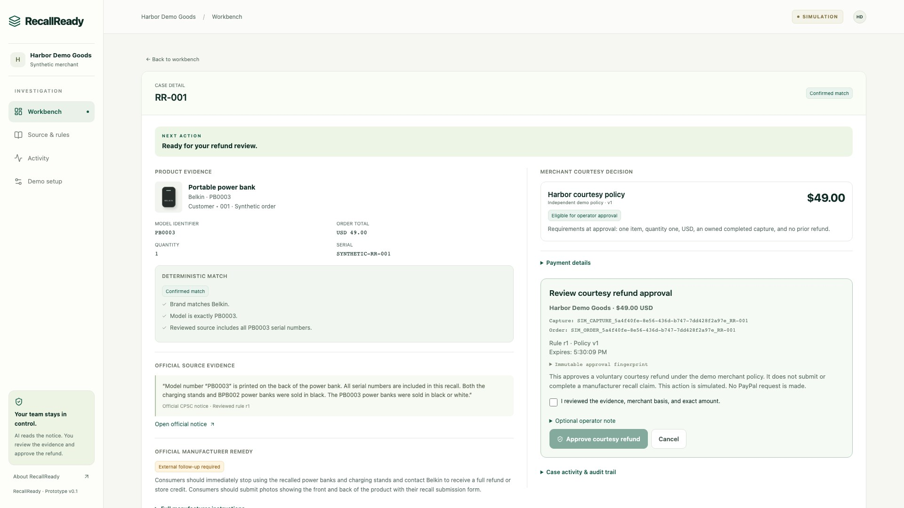

# UI/UX refresh · November 8, 2026

## Audience and direction

The user requested both a modern landing page and a simpler merchant workflow, using their pasted RecallReady reference. The implemented direction uses warm ivory, dark green, a restrained lime highlight, larger system typography, rounded panels, and consistent native controls. Decorative product previews use local HTML/CSS and the existing icon library.

The reference's email/SMS automation, support inbox, pricing, compliance claim, and invented customer totals were not added to the product copy. Current scope is official notice review, exact order triage, a separate merchant courtesy-refund approval, and auditable PayPal sandbox results. Public demo orders remain explicitly synthetic.

## Implemented

- Public landing page with audience, product explanation, three-step workflow, illustrative model comparison, and a working interactive-demo entry point.
- `/product` also lets the signed-in owner inspect the landing page. Its primary actions return to the existing workspace rather than initialize another simulation.
- Workbench with workflow progress, a next-action panel, live counts, order search, and four default table columns. Extra filters and inspection columns expand together through More filters.
- Clear empty-search state and reset action. A loading state avoids showing false zero counts before records arrive.
- Case view with a next-action summary, readable product/match facts, visible source quote, a short manufacturer-remedy excerpt, and the separate merchant decision.
- Full manufacturer instructions, payment identifiers, and the audit trail remain available in native disclosures. Refund controls retain their original deliberate confirmation and server-side approval contract.
- Source review with plain-language extraction and serial-scope labels, expandable technical metadata/full snapshot, and a direct continuation to order review after approval.
- Mobile navigation for Workbench, Notice, Activity, and Setup. Mobile lists link to complete case views. Layouts respect reduced-motion preferences and visible keyboard focus.
- Setup preserves completed purchase/refund records and removes the obsolete AG Studio deferral display.

## Verification and scope

The production build and TypeScript/lint checks passed during the refresh. The existing 111 unit/component checks and six browser workflows passed after the main redesign, including deliberate approval, refusal cases, duplicate-request handling, unknown outcome, tenant isolation, mobile details, and keyboard controls. Search, empty results/reset, and expanded filters were inspected in the browser. Screenshots are stored in `docs/reports/ui-*.jpg`.

The redesign changes presentation and navigation. It does not create new PayPal transactions, alter the existing approval records, send customer messages, or publish the project. The verified sandbox refund remains preserved.

A Figma design reference was attempted, but the connection expired before a file was created. Local app implementation continued successfully. No Figma deliverable is claimed.

## Case alignment correction · November 8, 2026

Standalone desktop cases now place product/source evidence beside the merchant policy and refund review. Gutters are aligned, the navigation and mode header stay anchored while scrolling, and the optional operator note is collapsed initially. Expanded immutable data wraps on phones. The workbench detail remains a single column.

Production build, TypeScript and focused lint passed. All six browser workflows passed. Layout checks at 1920×1080, 1440×900, 1280×720 and 390×844 found no horizontal overflow and visible approval controls; expanded fingerprint/note was also checked at 390 pixels. The screenshot below uses the isolated simulation for UI verification. Real sandbox footage and verification use the recorded owner workspace.

